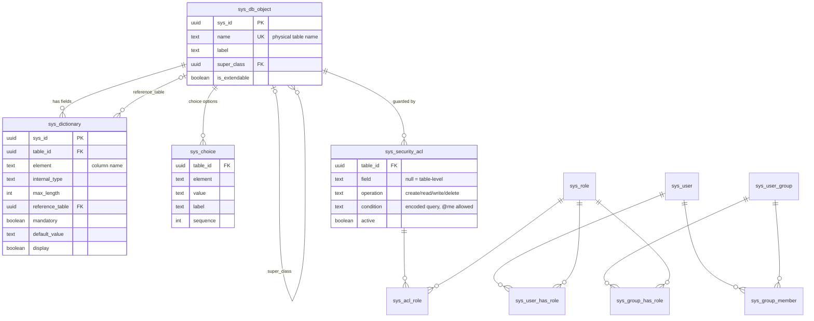

# Architecture

## The one idea

Everything the platform serves — tables, fields, choices, access rules — is
**data in `sys_*` tables**, not code. The application layer is a fixed engine
that interprets that data at request time. Creating a table writes metadata
rows *and* runs real DDL in the same transaction; from that instant the
generic REST API, list view and form view all work for the new table because
none of them ever knew about specific tables in the first place.

```mermaid
flowchart LR
    subgraph Metadata layer (Flyway-managed)
        DBO[sys_db_object<br/>one row per table]
        DICT[sys_dictionary<br/>one row per field]
        CHOICE[sys_choice]
        ACL[sys_security_acl + sys_acl_role]
    end
    subgraph Runtime (generated from metadata)
        PHYS[(Physical user tables<br/>task, incident, ...)]
        API[Generic Table API]
        UI[Metadata-driven UI]
    end
    DBO --> PHYS
    DICT --> PHYS
    DBO & DICT & CHOICE --> CACHE[SchemaCache<br/>in-memory, versioned]
    ACL --> ACLCACHE[AclService cache]
    CACHE --> API & UI
    ACLCACHE --> API
    API --> PHYS
```

## Package map

```
com.platform
  core/metadata   TableDefinition, FieldDefinition, DictionaryService, SchemaCache
  core/ddl        IdentifierValidator, DdlGenerator, SchemaMutationService
  core/query      EncodedQueryParser (+tokenizer), QueryNode AST, SqlBuilder,
                  QueryMatcher, RecordQuery
  core/record     RecordService (the choke point), Record, InheritanceResolver
  core/security   UserContext, AclService, AclEvaluator, UserService, JwtService
  core/tenant     TenantContext (constant "public" in v1; Phase 4 seam)
  api             TableApiController, MetaApiController, AuthController
  bootstrap       DemoDataSeeder
```

## Request lifecycle: HTTP → ACL → SQL

`GET /api/now/table/incident?sysparm_query=active=true^priority<=2`

1. **Auth filter** verifies the JWT, loads the user's roles from the DB
   (direct + via groups), and builds an immutable `UserContext`. Roles are
   resolved per request, so revocation is immediate.
2. **TableApiController** parses `sysparm_*` into a `RecordQuery`. It never
   builds SQL and cannot bypass ACLs — `fetch()` requires the `UserContext`.
3. **RecordService.fetch**:
   - resolves `incident` in the **SchemaCache** (no metadata-table reads on
     the hot path),
   - asks **AclService** for a read decision. Outcomes: *Allow* (no
     restriction), *Deny* (return empty without touching the DB), or
     *Restrict(condition)* — the ACL's own encoded-query condition as an AST,
     with `@me` resolved to the caller's sys_id,
   - ANDs the restriction into the user's query AST. **Denied rows are never
     fetched**; the `X-Total-Count` header is computed on the same filtered
     query.
4. **SqlBuilder** compiles the AST: every field name validated against the
   schema cache (unknown → 400), every identifier double-quoted and
   schema-qualified via `TenantContext`, every value a bound parameter.
   Inheritance JOINs and dot-walk LEFT JOINs are added here.
5. Rows come back, base columns from the root table; **field-level read
   ACLs** strip protected columns per record before the response is shaped.

Writes flow through the same choke point (`RecordService.insert/update/
delete`): coercion → defaults → table-level ACL (condition evaluated
in-memory against the record by `QueryMatcher`) → field-level ACLs (403
names the operation and field) → mandatory/choice validation → SQL. Phase 2
business rules will hook exactly here.

## The metadata tables



## Inheritance model (class-table / joined)

`incident extends task`:

- `task` owns the base columns (`sys_id`, audit fields, `sys_mod_count`,
  `sys_class_name`) and task's fields.
- `incident` owns **only** incident's fields plus
  `sys_id uuid primary key references task(sys_id) on delete cascade`.
- **Read incident** → `task JOIN incident USING (sys_id)`.
- **Write incident** → `InheritanceResolver` splits values by owning table;
  one row inserted into *every* chain table, root first, same `sys_id`, one
  transaction.
- **Query task** → the root table already contains one row per descendant
  record; `sys_class_name` (a stored column, set on insert) reports the
  actual class. Stored beats computed here: computing it would need a LEFT
  JOIN per child table on every read of every parent table, forever, to
  answer a question whose answer never changes after insert.
- **Delete** → delete the root row; FK cascade removes the chain.

Trade-off (see ADR-0002): storage stays clean and typed, no sparse columns —
at the cost of one JOIN per inheritance level on reads. This is the same
well-known performance characteristic that deeply extended ServiceNow tables
have.

## The schema cache

An immutable snapshot of the whole metadata graph (tables, fields, choices)
held in memory behind a `volatile` reference with a version counter.

- Readers grab the snapshot once per operation — a concurrent schema change
  can never hand them a half-updated graph.
- Schema mutations reload the cache wholesale **after commit**. Reload-the-
  world is deliberate: the graph is small, changes are rare and
  administrative, and atomic swap beats incremental patching on correctness.
- Normal record reads/writes never query `sys_*` tables.

## Schema mutation safety

- Metadata inserts + DDL in **one transaction** (Postgres transactional DDL).
- A `pg_advisory_xact_lock` serialises all schema changes: two concurrent
  "create table X" calls cannot interleave; the loser sees the winner's
  committed row and gets a clean 409 (integration-tested).
- Every identifier passes `IdentifierValidator` (regex
  `^[a-z][a-z0-9_]{0,58}$`, Postgres reserved-word reject-list, `sys_`
  namespace reserved) and is emitted double-quoted. Identifiers cannot be
  bound as parameters, so this validator is the entire injection defence on
  the DDL path — which is why it is one class, called by every path, and
  tested against injection payloads.

## ACL resolution

Most specific match wins, and only the winning level is evaluated:

1. field-level rules on the exact table
2. table-level rules on the exact table
3. the same pair for each ancestor, walking up `super_class`

Within a level, access is granted if **any** rule passes (user holds any of
the rule's roles — or the rule lists none — AND its condition matches the
record). No rules anywhere → **deny**, except `admin`, who bypasses
evaluation. Read conditions become SQL (row filtering); write/delete
conditions are evaluated in memory against the loaded record by
`QueryMatcher`, which shares the operator semantics with `SqlBuilder` by
construction (same AST, mirrored semantics).

## Future-phase seams (why some code looks "extra")

- Every mutation flows through `RecordService` → Phase 2 business rules
  attach there.
- Metadata loading/caching is generic over "records that define behaviour",
  not schema-specific — Phase 3 workflows are also just records.
- `TenantContext` threads schema qualification through all SQL today even
  though it always answers `public` — Phase 4 multi-tenancy swaps its
  implementation, not its call sites.
- The record layer has zero HTTP concerns — Phase 5 integrations layer on
  top rather than tangle in.
